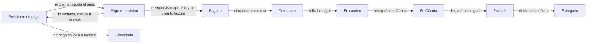

<p align="center">
  
</p>

# UyParce Shopper

App Android para gestionar compras por encargo en outlets de Estados Unidos con envío a Colombia.
Hecha en **Kotlin** con **Jetpack Compose** y **Firebase**, para la asignatura Tecnologías Móviles.

## La problemática

UyParce es un servicio de *personal shopping*: el equipo recorre outlets de New Jersey, publica las
prendas y los clientes en Colombia las encargan. La mercancía viaja en cajas hasta Cúcuta y desde allí
se despacha a la ciudad de cada cliente.

Coordinar todo ese proceso sin una herramienta propia trae varios problemas:

- Los clientes no tienen cómo ver el catálogo, hacer pedidos ni seguir el estado de su pedido por su cuenta.
- Los pagos se reportan con fotos de comprobantes que alguien debe revisar y relacionar con cada pedido.
- El trabajo del equipo es en movimiento (en el outlet, al empacar, al recibir en Cúcuta) y necesita la
  cámara y un lector de códigos de barras a la mano.

Para resolverlos, nuestro grupo diseñó y construyó UyParce Shopper desde cero: lleva todo el ciclo del
pedido al celular, con una cuenta para cada persona según su rol.

## Alcance de la beta

| Rol | Qué hace en la app |
|---|---|
| **Cliente** | Se registra y espera la aprobación del admin. Ve el catálogo, arma el carrito y confirma pedidos con el precio congelado. Paga por fuera y reporta el pago con la foto del comprobante. Sigue el estado del pedido, descarga su factura en PDF, decide qué hacer con las prendas que no llegaron (saldo a favor o devolución) y confirma la entrega. |
| **Operador** | Crea productos con fotos y un código de barras por talla. Registra lo que compra en el outlet escaneando la etiqueta, marca lo que no consiguió, y arma y sella las cajas. |
| **Supervisor** | Revisa los pagos y los aprueba o rechaza (al aprobar se crea la factura). Recibe las cajas en Cúcuta escaneando cada prenda y despacha con transportadora y guía. Maneja clientes, cartera, gastos y reportes. |
| **Admin** | Aprueba cuentas, crea las cuentas del equipo y configura la tasa del dólar, márgenes, comisiones, tarifas de envío, zonas y medios de pago. Ve estadísticas, auditoría y papelera. También puede hacer el trabajo del operador y del supervisor. |

### Ciclo de un pedido



Si una prenda no se consigue o no llega a Cúcuta, queda como **faltante** y el cliente elige saldo a
favor (se descuenta en su siguiente pedido) o devolución.

## Requisitos de la asignatura

| Requisito | Cómo lo cumple la app | Dónde verlo |
|---|---|---|
| Problemática | Sección anterior | Este archivo |
| Persistencia | Cloud Firestore guarda todos los datos en la nube y deja una copia en el celular para ver la información sin internet. Las cuentas son de Firebase Authentication. | `data/firebase/` |
| Clases modelo (POO) | Clases de datos, enumeraciones y objetos con su propia lógica: por ejemplo, `Pedido.avance()` decide el siguiente estado del pedido y `Precios` calcula el desglose. | `data/models/` |
| Listados | `LazyColumn` en catálogo, carrito, pedidos, pagos, cajas, usuarios, gastos y auditoría | `ui/screens/` |
| Formularios validados | Registro, inicio de sesión, reportar pago, producto, gasto, despacho y ajustes | `RegisterScreen.kt`, `ReportarPagoScreen.kt`, `OpProductoScreen.kt` |
| Cámara y galería | Fotos de los productos y del comprobante de pago, con la cámara o desde la galería, sin pedir permisos | `ui/components/Fotos.kt` |
| Adicionales | Lector de códigos de barras (Google Code Scanner), factura en PDF, reglas de seguridad por rol e ícono adaptable | `Escaner.kt`, `FacturaPdf.kt`, `firestore.rules` |

## Tecnologías

- Kotlin 2.2 y Jetpack Compose con Material 3
- Navigation Compose y ViewModel
- Firebase Authentication y Cloud Firestore (BoM 34.19.0)
- Google Code Scanner (ML Kit) para los códigos de barras
- Coil 3 para mostrar las fotos
- Android Gradle Plugin 9.4, mínimo Android 9 (API 28)

## Cómo está organizado el código

```
app/src/main/java/me/valeriaacosta/uyparceshopper/
├── MainActivity.kt         punto de entrada: tema, ViewModel y navegación
├── navigation/
│   ├── Routes.kt           rutas, pestañas de cada rol y qué rutas puede abrir cada uno
│   └── AppNavigation.kt    NavHost: la sesión decide a qué pantalla ir
├── data/
│   ├── models/             clases modelo: Usuario, Producto, Pedido, Pago, Caja, Factura…
│   ├── firebase/           un repositorio por colección de Firestore
│   ├── EstadoApp.kt        ViewModel: sesión, datos en vivo y acciones
│   ├── DatosEjemplo.kt     datos ficticios para las vistas previas (@Preview)
│   └── Fechas.kt, Errores.kt, Codigos.kt, FacturaPdf.kt
└── ui/
    ├── components/         piezas reutilizables: botones, campos, tarjetas, fotos, escáner…
    ├── screens/            una pantalla por archivo, separadas por rol
    │                       (auth, cliente, operador, supervisor, admin, compartidas)
    └── theme/              colores, tipografía y tema
```

En la raíz están `firestore.rules`, con las reglas de seguridad de la base de datos, y las pruebas en
`app/src/test/`.

El camino de cada acción es **pantalla → `EstadoApp` (ViewModel) → repositorio → Firebase**. Cada pantalla
recibe lambdas `onClick…` para navegar y tiene su `@Preview` con datos de ejemplo, así se puede ver en
Android Studio sin conectarse a Firebase.

### Orden sugerido para estudiarlo

1. `MainActivity.kt`, `navigation/Routes.kt` y `navigation/AppNavigation.kt`: cómo arranca la app y qué ve cada rol.
2. `data/models/Pedido.kt` y `data/models/Precios.kt`: los estados del pedido y cómo se calcula lo que paga el cliente.
3. `data/EstadoApp.kt`: la sesión, qué datos escucha cada rol y las acciones.
4. `data/firebase/PedidosRepositorio.kt`: un repositorio completo, con transacciones.
5. El flujo del cliente en `ui/screens/cliente/`: `CatalogoScreen` → `CarritoScreen` → `ConfirmarPedidoScreen` → `PagarPedidoScreen` → `ReportarPagoScreen`.
6. `firestore.rules`: quién puede leer y escribir cada colección.

## Cómo correr el proyecto

1. Clonar el repositorio y abrirlo en Android Studio.
2. Pedir el archivo `google-services.json` a quien administra el proyecto de Firebase del equipo y
   ponerlo en la carpeta `app/`. No está en el repositorio a propósito.
3. Tocar **Sync Project with Gradle Files** y luego **Run**, en un emulador o en un celular con Android 9 o más nuevo.

Sin `google-services.json` la app compila igual y abre una pantalla que explica que falta conectar Firebase.

**Cuentas:** los clientes se registran desde la app y el admin los aprueba. Las cuentas del equipo las crea
el admin en Usuarios → Agregar usuario, y a cada persona le llega un correo para crear su contraseña.

## Pruebas

`ModelosYReglasTest` tiene 21 pruebas que corren en el computador, sin Firebase:

- Cada modelo se convierte a lo que guarda Firestore y de vuelta, sin perder ni sobrar campos.
- El avance del pedido, el valor de un faltante, el saldo a favor, los códigos de barras y los mensajes de error.

Para correrlas: clic derecho sobre el archivo → **Run**, o en la terminal `./gradlew :app:testDebugUnitTest`.

## Estado y próximos pasos

- Beta con todas las pantallas conectadas a Firebase.
- Pendiente: pruebas de punta a punta con todos los roles y prueba del escáner con etiquetas reales.
- Límites del plan gratuito de Firebase:
  - Sin servidor, el plazo de 24 h para pagar se aplica cuando alguien abre la app.
  - Las fotos se guardan comprimidas en Firestore, porque el plan gratuito no incluye Storage.
  - Los avisos se ven dentro de la app, sin notificaciones push.
